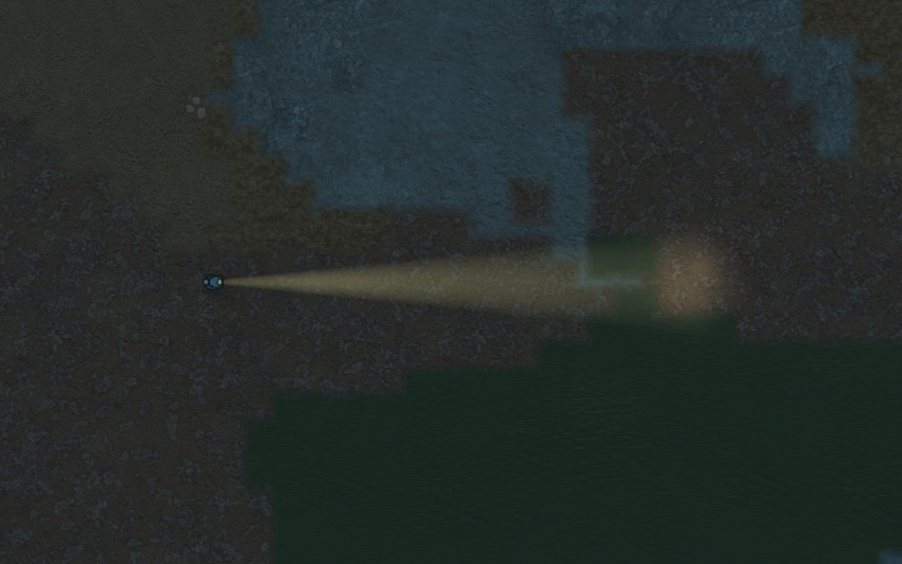
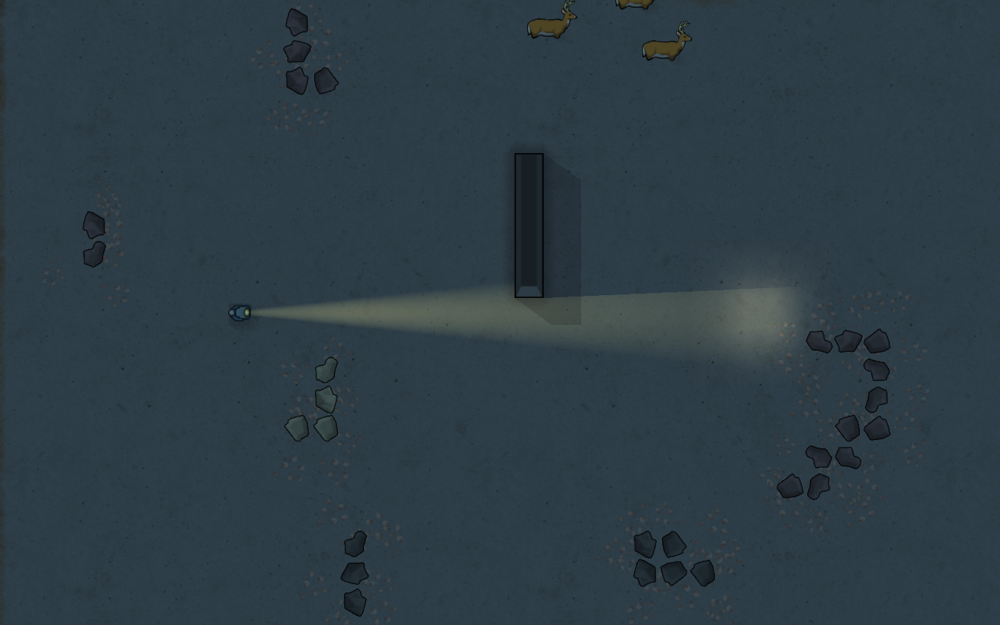

# Directed Searchlights

Directed Searchlights adds powered, directional searchlights for RimWorld 1.6
and 1.7. Turrets and towers can track hostile pawns up to 60 cells away. At the
default beam diameter, a target 60 cells away is illuminated by a beam about
3.8 degrees wide (four cells across at the target).

The mod includes English and Korean in-game text.

## Installation and controls

This folder is the mod root. Enable **Directed Searchlights** in RimWorld's
Mods menu and restart the game. The mod includes a built assembly. After
researching Electricity, build either light from the Security category and
connect it to power:

| Building | Power | Cost |
|---|---:|---|
| Searchlight turret | 150 W | 50 steel, 1 industrial component |
| Searchlight tower | 200 W | 75 steel, 1 industrial component |

The turret operates under a roof. The tower stops operating if its cell becomes
roofed. Click **Power Mode** on either building to cycle through three settings.

1. **Always on** (default) runs the selected beam mode while powered and switched on.
2. **Night only** suspends the beam, detection and power draw from 06:00 until
   18:00 local time. With Atmosphere Overhaul active it follows local sunrise and sunset.
3. **Activate on detection** scans day and night with the beam off and zero
   power draw until it detects an eligible enemy. Fixed lights illuminate their
   designated area. Sweep and Automatic lights track the target.

Each light saves its power mode. Older saves with both options enabled use
Activate on detection.

| Mode | Behavior |
|---|---|
| Fixed | Holds the direction and range set by the selected aim cell. |
| Sweep | Sweeps within a configurable sector (90 degrees by default, adjustable from 1 to 360 degrees). Targets must remain inside that sector. If it loses its target, it resumes its sweep. |
| Automatic | Patrols through 360 degrees and tracks valid hostile pawns. |

Select a building and designate an aim cell to set its direction and patrol
range. In Sweep and Automatic modes, **Select target** gives a valid hostile
pawn priority. The turret can acquire hostiles it can see. The tower can also
detect unroofed hostiles behind cover and prefers visible targets under all
three sharing policies. Walls and closed doors
block both beams. When tracking a moving target, the head can pan and tilt by
up to 2 degrees per tick on each axis. Tilt projects onto the ground from an
effective pivot height of two cells, so a small tilt moves the beam farther
at long range. With the head already facing the target, moving the aim from
15 to 60 cells takes 3 ticks. Turning sideways through 90 degrees takes 45.

In Sweep mode, choose **Adjust sweep sector** to open the map preview.

1. Move the mouse to aim the center of the sector.
2. Middle-click to adjust the full sweep angle. Move toward the light to narrow
   the sector or away to widen it. Middle-click again to lock the angle.
3. Hold Ctrl to preview which cells the beam can reach within the sector, up
   to 60 cells away. Left-click to apply, or right-click or press Escape to cancel.

Each light saves its own sector and shows the outline when selected. Editing
the sector preserves the patrol range set with **Set direction**. Lights from
saves created before the sector editor start with the original 90-degree width.

### Sharing targets and reporting hostiles

In Sweep and Automatic modes, the **Target sharing** setting controls how a
light chooses among eligible hostiles on its map.

| Policy | When the light needs a target |
|---|---|
| Spread | Prefer the least-reserved target it can see. A light sharing a lock can move to a free, visible target after holding its lock for at least 120 ticks and finding the same alternative on two consecutive scans. |
| Independent | Use the original target selection and keep a valid lock. |
| Concentrate | Choose the best eligible target regardless of other lights' reservations. Several lights can choose the same pawn. |

New lights start in Spread. Lights already in a pre-coordination save start
in Independent. A manual target takes priority in all three policies. Several
lights can be assigned to the same pawn by hand.

**Detection alerts** offers Off, Visual, or Visual + sound. Visual is the
default. You can change the default for newly built lights in Mod Settings.
Detections on the same map within 60 ticks share a message. Click it to visit
the original detection cell. A brief marker identifies hostiles that a light
can still detect, including unroofed targets a tower detects behind a wall.
The beam still has to reach a pawn to illuminate it.

A repeat alert requires a fresh acquisition, at least 2,500 ticks since the
previous notification, and a period of 120 consecutive ticks outside every
operating detector's coverage. Switching targets while an enemy remains
detectable does not rearm the alert. Lights with alerts turned off still
contribute to detection coverage.

The sweep editor is included in both the RimWorld 1.6 and 1.7 packages.
Combat Extended is optional.

## Beam and illumination

The mod setting controls the beam diameter at the aim distance, from 2 to 6
cells. For aim distance `d` and diameter `w`, the full beam angle is
`min(24 degrees, 2 * atan(w / (2 * d)))`. An obstruction does not change the
zoom: it remains based on the aim distance. With the default four-cell
diameter, the beam is about two cells wide where it is blocked halfway along a
60-cell aim.

In Mod Settings, **Lighting in this save** selects how a searchlight illuminates
the ground. New games and existing saves default to **Endpoint only**. With
Harmony enabled, select **Reached beam cells** to illuminate intermediate
cells as the head pans.
Each cell's center must lie inside the beam and have a clear path from the
lens. A wall or closed door blocks light at its near face. A pawn crossing the
beam can gain light independently of the light's selected target. Where beams
overlap, the stronger contribution applies. Changing the setting affects every
map in the current save.

In **Reached beam cells**, cover casts a directional shadow on both the
visible beam and the ground light used by the game. A stone chunk blocks 50%
of the light behind it. Pawns with a defined cover value use it. Other pawns
block 35% per unit of current body size, up to 90%. The cell occupied by the
first pawn still gets the incoming light. Two ordinary adults in successive
cells leave about 42% of the original searchlight contribution behind them.
In a shared cell only the strongest cover counts.

In **Endpoint only**, actual illumination comes from a vanilla light source
placed at the reached endpoint. Its physical radius is
half the beam width at that point. With the default setting, the endpoint
radius is about 2 cells at full range and about 1 cell when blocked halfway
along a 60-cell aim. A minimum radius of 0.5 cells is used when the beam is
blocked close to the building so the cell center is illuminated.

In endpoint mode, intermediate cells outside the endpoint radius remain dark. The endpoint light can
illuminate cells outside the visible beam near its endpoint because vanilla
lighting spreads radially. Combat Extended (CE) combines vanilla lighting with
the shooter's night-vision capability. The documented nighttime combat-glow
cap of 0.5 was verified with CE 16.7.4.0.

Power use is 150 W for the turret and 200 W for the tower. These are three and
four times the researched vanilla floodlight's 50 W, respectively. The added
cost is for long-range tracking and the tower's additional detection ability.
See [the power comparison](docs/verification/power-balance.md).

The beam has a rounded visual falloff beyond the aim point. At the
default diameter, the visible cap can extend up to 2 cells past the aim point;
target detection and actual light range remain capped at 60 cells. Walls and
closed doors also clip the visual cap.

The overlay dims as its cross-section grows. A softened inverse-area curve
multiplies opacity by `1 / (1 + (local diameter / 6)^2)`: at six cells across,
half of the original opacity remains. This is an artistic approximation,
not a lux simulation. Auto-zoom preserves the same attenuation for equal
target widths at different ranges. This effect does not alter the endpoint
light or CE calculations.

## Build

On Windows, install the .NET SDK and, for RimWorld 1.6, the .NET Framework
4.7.2 targeting pack. The 1.7 target uses .NET 10. The development build was
tested with RimWorld 1.6.4871 rev590 and .NET SDK 10.0.404.

Run from PowerShell in this mod folder:

```powershell
.\build.ps1
# When the game is installed somewhere other than the default location:
.\build.ps1 -RimWorldPath 'D:\SteamLibrary\steamapps\common\RimWorld'
```

The script detects the installed game version and writes
`1.6/Assemblies/DirectedSearchlights.dll` or
`1.7/Assemblies/DirectedSearchlights.dll`. Both targets build from the same
C# source. The 1.7 target uses the game's compatibility assemblies. During a
1.7 build, `1.7/Defs` is copied from `1.6/Defs`; make Def changes in the 1.6
folder. Game assemblies are build references and are not distributed with the
mod.

## Credits and references

The operating modes and endpoint-light concept were inspired by Rikiki's
MiningCo. Projector. This mod uses its own Defs, code, and graphics:
[Rikiki's Ludeon forum thread](https://ludeon.com/forums/index.php?topic=14711.msg153946#msg153946),
[MiningCo. source](https://github.com/Rikiki123456789/Rimworld/tree/master/MiningCo.%20Projector),
and [Zaljerem's 1.6 port](https://steamcommunity.com/sharedfiles/filedetails/?id=3712705276).

These Combat Extended source files were consulted for target lighting and
shooting penalties:
[LightingTracker](https://github.com/CombatExtended-Continued/CombatExtended/blob/d847807b84ab7c140f89390c3032e3947b9ab386/Source/CombatExtended/CombatExtended/LightingTracker.cs)
and
[Verb_LaunchProjectileCE](https://github.com/CombatExtended-Continued/CombatExtended/blob/d847807b84ab7c140f89390c3032e3947b9ab386/Source/CombatExtended/CombatExtended/Verbs/Verb_LaunchProjectileCE.cs).

## Verification

The [coordination verification record](docs/verification/coordination/README.md)
includes the shared-target night scene, migration checks and reproduction
commands. Earlier lighting and compatibility results are in the
[MVP verification record](docs/verification/README.md).

Both screenshots were captured at night in RimWorld 1.7.5013. Each turret is
in Fixed mode, aimed 18 cells away with the default
four-cell beam diameter.



In the second scene, a wall clips the upper edge of the beam. The lower part
passes the corner, and the illuminated endpoint still measures 0.5 ground glow.


