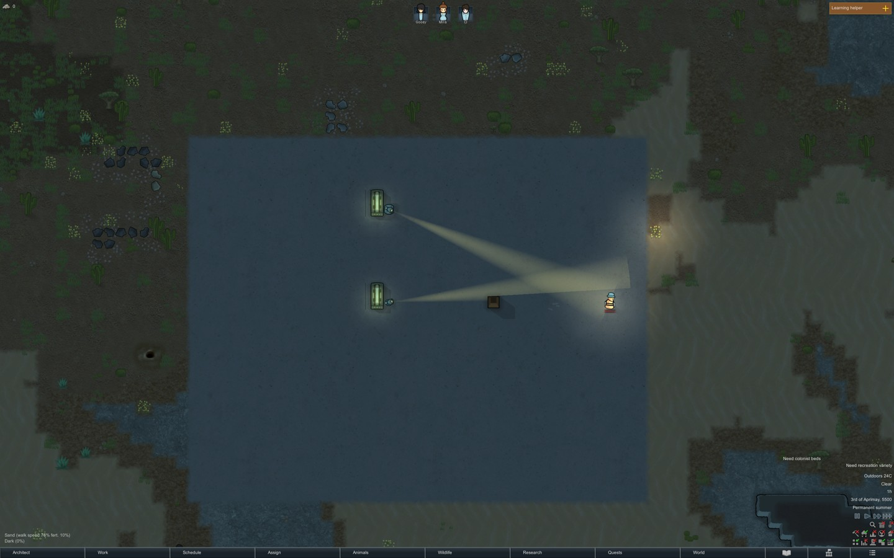

# Directed Searchlights

Directed Searchlights adds powered, directional searchlights for RimWorld 1.6
and 1.7. Turrets and towers can track hostile pawns up to 60 cells away. At the
default beam diameter, a target 60 cells away is illuminated by a beam about
3.8 degrees wide (four cells across at the target).

English is the default language for project documentation. In-game translations
remain in the localized files under `Languages/` and the version-specific
`DefInjected` folders.

## Installation and controls

This folder is the mod root. Enable **Directed Searchlights** in RimWorld's
Mods menu and restart the game. The mod includes a built assembly. After
researching Electricity, build either light from the Security category and
connect it to power:

| Building | Power | Cost |
|---|---:|---|
| Searchlight turret | 150 W | 50 steel, 1 industrial component |
| Searchlight tower | 200 W | 75 steel, 1 industrial component |

The turret operates under a roof. The tower stops operating if its cell becomes
roofed.

| Mode | Behavior |
|---|---|
| Fixed | Holds the direction and range set by the selected aim cell. |
| Sweep | Sweeps up to 45 degrees to either side of the selected direction. If it loses its target, it resumes its sweep. |
| Automatic | Patrols through 360 degrees and tracks valid hostile pawns. |

Select a building and designate an aim cell to set its direction and patrol
range. In Sweep and Automatic modes, you can also designate a pawn manually.
The tower can detect outdoor enemies through walls, but the beam itself is
occluded by walls and closed doors, just like the turret's beam.

## Beam and illumination

The mod setting controls the beam diameter at the aim distance, from 2 to 6
cells. For aim distance `d` and diameter `w`, the full beam angle is
`min(24 degrees, 2 * atan(w / (2 * d)))`. An obstruction does not change the
zoom: it remains based on the aim distance. With the default four-cell
diameter, the beam is about two cells wide where it is blocked halfway along a
60-cell aim.

The beam is rendered as an overlay. Actual game illumination comes from a
vanilla light source placed at the reached endpoint; its physical radius is
half the beam width at that point. With the default setting, the endpoint
radius is about 2 cells at full range and about 1 cell when blocked halfway
along a 60-cell aim. A minimum radius of 0.5 cells is used when the beam is
blocked close to the building so the cell center is illuminated.

The beam itself does not light intermediate cells. The endpoint light can
illuminate cells outside the visible beam near its endpoint because vanilla
lighting spreads radially. Combat Extended (CE) combines vanilla lighting with
the shooter's night-vision capability. The documented nighttime combat-glow
cap of 0.5 was verified with CE 16.7.4.0.

Power use is 150 W for the turret and 200 W for the tower. These are three and
four times the researched vanilla floodlight's 50 W, respectively. The added
cost is for long-range tracking and the tower's additional detection ability,
not for a stronger endpoint light. See [the power comparison](docs/verification/power-balance.md).

The 1.7 build adds a rounded visual falloff beyond the aim point. At the
default diameter, the visible cap can extend up to 2 cells past the aim point;
target detection and actual light range remain capped at 60 cells. Walls and
closed doors also clip the visual cap. The bundled 1.6 assembly predates this
visual update; rebuild against a RimWorld 1.6 installation to produce a 1.6
assembly from the current source.

## Build

On Windows, install the .NET SDK and, for RimWorld 1.6, the .NET Framework
4.7.2 targeting pack. The 1.7 target uses .NET 10. The development build was
tested with RimWorld 1.6.4871 rev590 and .NET SDK 10.0.404.

Run from PowerShell in this mod folder:

```powershell
.\build.ps1
# When the game is installed somewhere other than the default location:
.\build.ps1 -RimWorldPath 'D:\SteamLibrary\steamapps\common\RimWorld'
```

The script detects the installed game version and writes
`1.6/Assemblies/DirectedSearchlights.dll` or
`1.7/Assemblies/DirectedSearchlights.dll`. RimWorld 1.7.5011 is built from the
same C# source using the game's .NET 10 compatibility assemblies. During a
1.7 build, `1.7/Defs` is copied from `1.6/Defs`; make Def changes in the 1.6
folder. Game assemblies are build references and are not distributed with the
mod.

## Credits and references

The operating modes and endpoint-light concept were inspired by Rikiki's
MiningCo. Projector. This mod uses its own Defs, code, and graphics:
[Rikiki's Ludeon forum thread](https://ludeon.com/forums/index.php?topic=14711.msg153946#msg153946),
[MiningCo. source](https://github.com/Rikiki123456789/Rimworld/tree/master/MiningCo.%20Projector),
and [Zaljerem's 1.6 port](https://steamcommunity.com/sharedfiles/filedetails/?id=3712705276).

These Combat Extended source files were consulted for target lighting and
shooting penalties:
[LightingTracker](https://github.com/CombatExtended-Continued/CombatExtended/blob/d847807b84ab7c140f89390c3032e3947b9ab386/Source/CombatExtended/CombatExtended/LightingTracker.cs)
and
[Verb_LaunchProjectileCE](https://github.com/CombatExtended-Continued/CombatExtended/blob/d847807b84ab7c140f89390c3032e3947b9ab386/Source/CombatExtended/CombatExtended/Verbs/Verb_LaunchProjectileCE.cs).

## Verification

See the [verification record](docs/verification/README.md) for the tested game
versions, scenarios, measurements, and reproduction commands. A night-tracking
scene is shown below.


