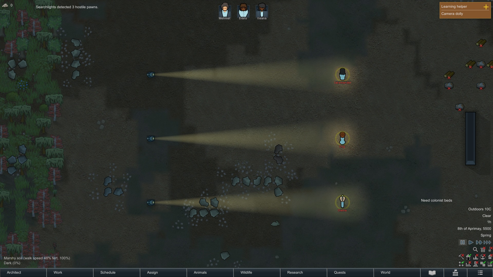

# Target sharing and detection alerts

The fixtures use isolated save-data profiles and the packaged mod. Each
coordination run starts with a fresh map, writes a save and opens it in a new
game process. The legacy upgrade run takes a save written by the earlier
ten-lamp vanilla runtime fixture.

## Builds and regression checks

| Game | DLL SHA-256 from the coordination verification run |
|---|---|
| RimWorld 1.6.4871 | `F34284EB55412B3E1A758435F0FC082DF0D1A05830DC2110328C10082390BD53` |
| RimWorld 1.7.5013 | `E2E41E8C9D4E53E3B44F5138F8AB341ACEF7E1657B61012D3D2392AD5EE5C74C` |

The 1.6 Independent gameplay scenarios, vanilla runtime with save/load, CE
runtime, optics and visual checks passed. CE 16.7.4.0 measured nighttime
combat glow of 0.5, 0 and 0.5 with the lights on, off and restored at the same
shooter and target cells. The corresponding lighting penalties were 0.5, 1
and 0.5. Advanced night-vision goggles reduced the illuminated center penalty
to 0.2 in the optics fixture. The installed CE package supports RimWorld 1.6.

RimWorld 1.7.5013 passed the Independent gameplay scenarios, vanilla runtime
with save/load and visual checks. In both game versions the night fixture
measured 0.5 endpoint ground glow at 18 and 60 cells. A wall at cell 30 stopped
the endpoint at cell 29. The three-light scene produced three distinct locks.

Clean builds of the committed source matched both DLLs byte for byte. The
geometry checks and both package checks passed. The gameplay fixtures
exercise real map updates. The allocation fixture forces power to isolate
target selection, and the runtime fixture uses spawned generators.

## Assignment and notification checks

The PR review reruns on 1.6.4871 and 1.7.5014 passed with a second pawn
detected at the same cell while the first message was still live. Both pawns
shared the message, and the second detection produced its marker and requested
sound. Both runs also passed the per-tick snapshot check for 1, 10 and 50 lamps.

On both versions the scenario runner connected a 150 W turret to a vanometric
power cell, saved during daytime standby and loaded the save in a new game
process. The turret drew 0 W after reload, resumed its configured 150 W draw
at 18:00 and returned to standby at 06:00. Removing the generator left the
turret dark the following evening.

Ten lights acquiring one pawn produced one message. Switching power off and
on and reloading a current save preserved alert suppression. The fixtures
checked the 60-tick message batch, 180-tick marker lifetime, 119/120-tick
absence boundary and 2,499/2,500-tick cooldown boundary. A tower detected a
hostile behind a wall while its beam stopped at the wall. Fog cleared a target's
marker; selecting Off on all remaining detectors cleared the others.

With three eligible hostiles, the 120-tick samples below recorded the work
performed by due acquisition scans. A candidate evaluation is one lamp checking
one candidate. It excludes retained-lock and marker validation. Each sample
produced zero notifications with alerts off.

| Lamps | Scheduled scans | Candidate snapshots | Candidate evaluations |
|---:|---:|---:|---:|
| 1 | 4 | 1 | 3 |
| 10 | 40 | 40 | 30 |
| 50 | 200 | 120 | 150 |

Three Spread lights settled on three distinct targets in 30 ticks on 1.6.4871,
26 ticks on 1.7.5013 and 22 ticks on 1.7.5014. The latter run used the same
bundled 1.7 DLL. The logs include elapsed wall time for the 1-, 10- and 50-lamp
samples. Frame pacing and game speed affect these measurements.
[1.6.4871 results](game-1.6.4871.txt), [1.7.5013 results](game-1.7.5013.txt)
and [1.7.5014 results](game-1.7.5014.txt).

## Upgrade from the MVP

The RimWorld 1.6.4871 vanilla runtime fixture wrote a save with the pre-update
DLL from commit `6abb8ff`. On loading it with the coordination package, all ten
lamps had Independent targeting and Visual alerts. An original lock survived.
Releasing every lock and reacquiring the original pawn produced zero messages.
Acquiring a newly spawned hostile produced one. [Legacy upgrade results](legacy-1.6.txt)

## Night-raid controls

In RimWorld 1.6, three Spread lights acquired three different hostiles and
displayed one silent message with three markers. Selecting Concentrate on the
middle light kept its current target. Manually assigning a neighbor's target
gave both lights the same lock. Selecting Off suppressed a new acquisition
message. Selecting Visual + sound produced one new message and one dispatch of
the game's neutral-event sound. Speaker volume was not measured.

After the detected pawn moved from (101, 125) to (107, 127), clicking the
message moved the camera to (101, 125). Clicking the normal power control
queued a flick job. The runtime fixture separately exercises actual power
loss and restoration.



## Reproduction

Run from the mod root in PowerShell. Set `$game` to the installation being
tested. Install or link this checkout in that installation's Mods folder.
After building, confirm that the installed path contains the rebuilt DLL for
that game version before running the coordination tests. The runner stages
only its harness and does not verify which searchlight DLL the game loads.

```powershell
.\build.ps1 -RimWorldPath $game
.\Tests\Coordination\Run-Coordination.ps1 -RimWorldPath $game
.\Tests\Coordination\Run-Coordination.ps1 -RimWorldPath $game -LegacySave $oldRuntimeSave
.\Tests\Visual\Run-Visual.ps1 -RimWorldPath $game
```

For the upgrade check, set `$oldRuntimeSave` to the `Saves/searchlight-runtime.rws`
file from a pre-coordination vanilla runtime run. The runner copies it into a
fresh test profile.
