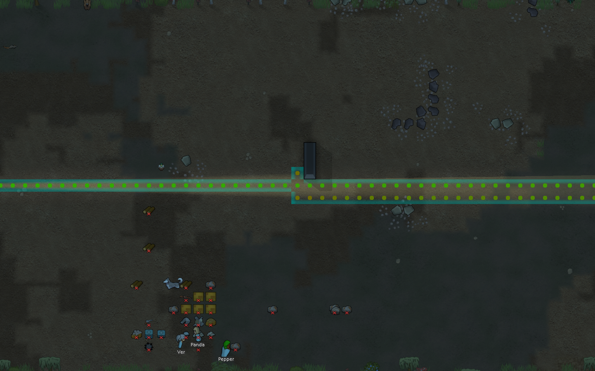

# Per-cell illumination verification

## Endpoint reference

On RimWorld 1.6.4871 (Version.txt rev590, runtime rev591), CE 16.7.4.0,
the isolated optics fixture passed on the pre-change assembly
`c349eb94-bbee-476d-bf49-2d011a0a8863`. A fixed light aimed 15 cells away
gave 0.5 ground glow and 0.5 combat glow at the endpoint at sky glow zero.
The unaided lighting shift was 0.5. At seven cells the ground glow was zero
both on and off. Reproduce from the mod root with
`./Tests/Optics/Run-Optics.ps1 -RimWorldDir $game16`.

## Installation paths used

- 1.6.4871 rev590: Steam `steamapps/content/app_294100/depot_294104`.
- 1.7.5014 rev1195: Steam `steamapps/common/RimWorld`.

Both installed game assemblies expose the integer-index overload of
`Verse.GlowGrid.GetAccumulatedGlowAt`. Vanilla gameplay brightness and visual
RGB read this value. The section lighting overlay regenerates from
`VisualGlowAt`. `DirtyCell` marks ground-glow meshes and publishes a cell
change event. The getter preserves cave-plant filtering and checks vacuum
terrain before returning the stored color. These are static inspection
results. Runtime checks are recorded separately.

The endpoint visual fixtures also passed before the adapter change on both
installations. At aim distances of 18 and 60 the spot was at the aim cell.
A wall at distance 30 moved the spot to cell 29. All three endpoint samples
measured 0.5 artificial ground glow at sky glow zero. Reproduce with
`./Tests/Visual/Run-Visual.ps1 -RimWorldPath $game`.

CE 16.7.4.0 reads `GroundGlowAt` in its lighting tracker and caches sampled
values. The integration fixture allows simulation ticks between transitions
so CE can refresh and the game can rebuild lighting sections.

## One-cell adapter

The Release adapter passed fresh-game and second-process reload checks on
1.6.4871 with Harmony (0Harmony 2.4.3.0), both with and without CE 16.7.4.0,
and on 1.7.5014 with Harmony (0Harmony 3.0.0.0). Each runner checked the
loaded mod MVID. A Harmony postfix augments the indexed accumulated-color
query. A prefix on the grid update drains changed cell indices and invokes
the game's own invalidation. No game or Harmony DLL is distributed.

| Night sample | Field off | Field on | Removed |
|---|---:|---:|---:|
| Target artificial ground glow | 0 | 0.5 | 0 |
| Target visual RGB, each channel | 0 | 64 | 0 |
| Target overlay center vertex, each channel | 0 | 16 | 0 |
| 1.6 CE combat glow | 0 | 0.0806 | 0 |
| 1.6 CE lighting shift | 1 | 0.9194 | 1 |

A lower field value of 20 produced ground glow 0.2824. Adjacent cells across a
section boundary retained zero artificial ground glow while their shared mesh
corners refreshed. The daylight sample remained 1, and the torch-only sample
returned to 0.1553 after removing the field. Reload restored the torch and
dark field baseline, and republishing the transient cell reproduced the light.

Reproduce with `./Tests/Lighting/Run-Lighting.ps1 -RimWorldPath $game -Case vanilla`
on both games and `-Case ce` on 1.6. The initial fixture exposed an invalid
argument order in the game's debug mesh reporter. The passing fixture reads
the finalized overlay mesh's actual vertex colors and verifies both sides of
a section boundary.

## Gameplay field

On 1.6.4871 with CE 16.7.4.0, the precise-mode fresh-map and reload fixture
passed with production assembly MVID `a2751951-01c2-4753-af2b-7e926d089d1b`.
The range-by-width fixture covers 5, 10, 30 and 60 cells at diameters 2, 4 and
6. At 60 cells and diameter 4, the focus and midpoint both measured 0.5
artificial ground glow, with raw RGB channel values of 36 and 46 respectively.
Outside and past-range probes measured zero. The gameplay profile normalizes
a width factor of `1 / (1 + (width / 6)^2)` at width four and multiplies it
by `1 - 0.8 × lane²`, where lane runs from -1 to 1 across the lens.

A cell lit separately at 43 and 33 raw RGB retained 43 with both lamps on.
Turning off the stronger source revealed the weaker source and removing the
last source cleared the cell. During a turning acquisition the target stayed
dark for 41 intermediate ticks. The diagonal walk reported 112 between-cell
samples. Reload restored the saved lighting mode and brightness, and despawn
removed the rebuilt field.

Turning and tracking publish the pose and cell field in the same simulation
tick. A stationary lamp polls for obstructions every 15 ticks. The door
benchmark toggles every 90 ticks and samples 60 ticks later, so it verifies
the resulting open and closed states without measuring first-response latency.

| CE 16.7.4.0 sample | Ground glow | Combat glow | Unaided shift | Advanced-goggles shift |
|---|---:|---:|---:|---:|
| Center, on | 0.5000 | 0.4466 | 0.5534 | 0.2213 |
| Edge, on | 0.4094 | 0.3423 | 0.6577 | 0.2631 |
| Remote cell, on | 0 | 0 | 1 | 0.4 |
| Center, off | 0 | 0 | 1 | 0.4 |

The final 1.6 DLL also passed the CE fresh-game and reload run with an
additional probe in a dark boundary cell. Its raw RGB and artificial ground
glow were zero, while CE combat glow was 0.0260 and unaided shift was 0.9740.
Adjacent lit cells account for that CE reading.

The field uses the game's usual lighting caps. CE reads the resulting ground
glow through its normal vision calculation. The precision setting adds no CE
patch or separate weapon modifier.

For the gameplay samples run
`./Tests/Lighting/Run-Lighting.ps1 -RimWorldPath $game16 -Case ce -Mode precise`.
Replace `-Case ce` with `-Case vanilla` for the vanilla game and `-Mode precise`
with `-Mode legacy` for the endpoint comparison. `-Lifecycle` exercises a second
map and loads a separate copy of the fixture save with the lighting-mode game
component removed to reproduce the old-save default.

## Visual clipping

The 1.7.5014 visual fixture captured each scene with and without the diagnostic
cell mask. The wall-side lane is dark behind the wall and the open side remains
lit. The rendering extends to 62 cells for a default 60-cell aim. The measured
artificial ground glow one cell beyond the focus is zero, although the vanilla
overlay interpolates neighboring vertex colors there.



## Final package and regression checks

| Game | Package MVID | SHA-256 |
|---|---|---|
| 1.6.4871 rev590 | `d5b7a1c0-4f6a-461e-a840-1116f383bfbe` | `E75525A593696E1463FDB7DE17D8AC8484F0393B5F97297E1B41E9663BCDA256` |
| 1.7.5014 rev1195 | `4472a310-f3f4-4449-b84c-86b47b53f9bd` | `ECB06F447980ACC9D3E6B6938D6E35EAC068EAD0D57515CDF8E1F5363A07E358` |

Both Release builds and both versioned package checks passed. The geometry
suite passed its exhaustive scan-bound comparisons. Vanilla gameplay and
two-map lifecycle fixtures passed on both versions, including mode switching,
three unloads with a lamp still registered and a missing-mode save reloaded
into endpoint mode. Each unloaded map lost its adapter state. The fixture
records managed heap after collection and whether the game still retains
the map. This distinguishes adapter cleanup from process-wide memory usage.

Both versions passed the ordinary scenarios, coordination and visual checks
in both lighting modes, and vanilla runtime save/load. The 1.6 runtime
and optics runners also passed with CE 16.7.4.0. The installed CE package
targets 1.6. The isolated Atmosphere Overhaul scenario on each game checked
24 previously lit cells, including an intermediate cell. Losing the last
target and crossing the local solar horizon each restored baseline glow at
zero watts. AO assembly MVIDs were `c1ddaa8b-9700-4168-9ac9-98b129428746`
on 1.6 and `75b5b40c-5c2c-4834-9446-a4f834c436cb` on 1.7.

Reproduction from the mod directory, with `$game` set to the selected game:

```powershell
./build.ps1 -RimWorldPath $game
dotnet run --project Tests/Geometry/GeometryTests.csproj -c Release
./Tests/VerifyPackage.ps1 -GameVersion 1.6
./Tests/VerifyPackage.ps1 -GameVersion 1.7
./Tests/Scenarios/Run-Scenarios.ps1 -RimWorldPath $game
./Tests/Scenarios/Run-Scenarios.ps1 -RimWorldPath $game -PreciseLighting
./Tests/Coordination/Run-Coordination.ps1 -RimWorldPath $game
./Tests/Coordination/Run-Coordination.ps1 -RimWorldPath $game -PreciseLighting
./Tests/Visual/Run-Visual.ps1 -RimWorldPath $game
./Tests/Visual/Run-Visual.ps1 -RimWorldPath $game -PreciseLighting
./Tests/Runtime/Run-Runtime.ps1 -RimWorldDir $game -Case vanilla
./Tests/Runtime/Run-Runtime.ps1 -RimWorldDir $game16 -Case ce
./Tests/Optics/Run-Optics.ps1 -RimWorldDir $game16
```

## Performance and default mode

Endpoint lighting remains the default for new games on both versions. With
ten continuously rotating lights, precise lighting exceeded both whole-tick
budgets. The per-save setting allows players to enable the field or switch
back to endpoint lighting.

The benchmark ran the packaged Release DLLs sequentially on Windows 11
(build 26300), an i5-13600KF, 32 GB of RAM and an RTX 3080 Ti. Both games
used the seed `SearchlightPerf`, tile 92897, a fixed camera, Harmony, and
the benchmark harness. Each window had 600 warmup ticks and 3,600 measured
ticks. The two modes alternated execution order between repeats. The table
shows the median of three paired percentage changes in simulation tick time,
relative to endpoint mode. The ten-light limits are below 10% for median
tick time and below 20% for p95.

| Workload, ten lights | 1.6 median | 1.6 p95 | 1.7 median | 1.7 p95 |
|---|---:|---:|---:|---:|
| Stationary | −1.30% | −3.80% | +4.11% | −15.46% |
| Continuous rotation | +54.20% | +45.80% | +42.35% | +28.28% |
| Moving target | +108.53% | +26.06% | +62.44% | +20.70% |
| Repeated door opening and closing | −4.13% | +1.74% | −4.53% | −2.96% |

Both versions stayed within budget when stationary and when doors cycled.
Field generation was the largest measured lighting cost during rotation.
For example, over 3,600 ticks with ten rotating lamps on 1.6, the middle
repeat spent 2,215 ms generating fields, 673 ms combining them, 120 ms
queuing invalidations and 411 ms flushing queued changes.

With 50 lamps following a moving target, median tick time increased by 214%
on 1.6 and 149% on 1.7. After three map unloads and a forced collection,
retained managed memory increased by 3.34 MiB on 1.6 and 2.86 MiB on 1.7.
The 1.6 runtime reported zero working set and zero allocated bytes even
during active workloads. Those counters cannot establish allocation rates.

The raw records contain all 72 measurement windows per version, including
zero-lamp controls, 50-lamp stress runs, stage timings and the unload result.
See [1.6 samples](performance-1.6.txt) and [1.7 samples](performance-1.7.txt).

```powershell
./Tests/LightingPerformance/Run-LightingPerformance.ps1 -RimWorldPath $game -Full
./Tests/LightingPerformance/Summarize-LightingPerformance.ps1 -ResultPath ./docs/verification/illumination/performance-1.6.txt -EnforceGate
./Tests/LightingPerformance/Summarize-LightingPerformance.ps1 -ResultPath ./docs/verification/illumination/performance-1.7.txt -EnforceGate
```

The initial benchmark incorrectly treated a walker returning to its starting
cell as stationary. The stationary and rotating windows finished before that
check. The moving-target and door workloads ran again from the same seed with
the corrected check, which counts actual cell transitions and verifies that
all lights retain the walker as their target.
