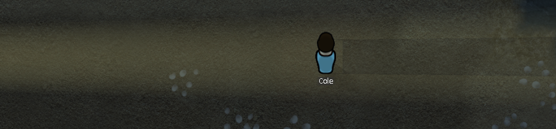
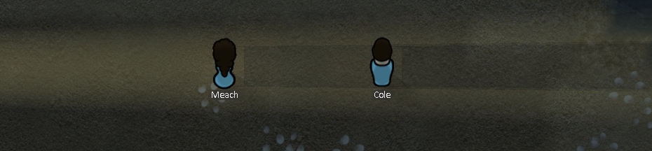
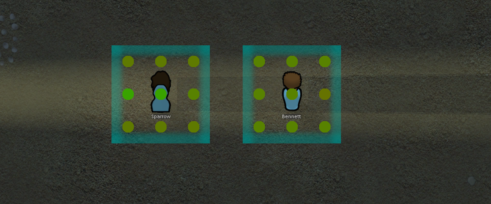

# 탐조등의 폰 중심 조명과 부분 그림자 검증

기존 정밀 모드(`PreciseField`)를 **빔 안의 폰 조명**으로 교체했다. 빔과 그림자는 바닥 전체에 그린다. 게임 조도에는 빔이 실제로 도달한 모든 폰이 선 칸을 반영한다. Combat Extended(CE)를 사용하면 각 폰의 주변 8칸도 개별적으로 빔 경계와 차폐를 검사한다. 저장된 모드 값은 그대로 읽으며, 기본 모드는 **빔 끝만 조명**이다.

## 그림자를 계산하는 기준

폰은 종족 정의의 기본 엄폐율이 양수이면 그 값을 사용한다. 그 외에는 현재 성장 단계를 반영한 `Pawn.BodySize`에 0.35를 곱하고 최대 90%로 제한한다. 체구 0.5, 1, 2의 차광률은 각각 17.5%, 35%, 70%다. 식물, 건물, 바닥 아이템에는 게임의 기본 엄폐율을 사용한다.

광선이 물체를 빠져나온 다음부터 빛이 줄어든다. 같은 칸에서는 가장 강한 차폐물 하나만 세고, 여러 칸에 걸친 동일 물체나 한 칸에 쌓인 아이템은 한 번만 센다. 광선이 모서리에 한 점만 닿으면 부분 차폐를 적용하지 않는다. 벽과 닫힌 문에서는 빔이 멈추고 열린 문은 빛을 통과시킨다.

## 같은 위치에서 비교한 실제 게임 화면

RimWorld 1.7.5021에서 탐조등을 동쪽으로 고정하고 40칸 지점에 수신 폰을 세웠다. 두 번째 장면에서만 탐조등으로부터 36칸 지점에 성인 폰 한 명을 추가했다. 빛은 왼쪽에서 오른쪽으로 진행한다. 두 캡처에서 같은 영역을 잘랐으며 밝기와 색상은 원본 그대로다.

**수신 폰만 있을 때** — 수신 폰 위치의 실제 조도는 **0.5000**이다.

**앞에 성인 폰을 추가했을 때** — 왼쪽 폰의 칸은 **0.5000**을 유지하고 오른쪽 수신 폰은 **0.3247**로 낮아졌다. 왼쪽 폰 뒤에서 시작한 그림자가 오른쪽 폰까지 이어진다.

전체 화면에서도 같은 장면을 확인할 수 있다. [1.6 원본](pawn-shadow-1.6.png) · [1.7 원본](pawn-shadow-1.7.png) · [세 환경의 장면별 측정 원본](visual-measurements.txt)

## 바닐라 실제 조도 측정

하늘빛을 제외한 `GroundGlowAt`을 측정했다. 1.6.4871과 1.7.5021에서 아래 결과가 일치했다.

| 측정 지점 | 수신 폰만 | 성인 폰 추가 |
|---|---:|---:|
| 앞쪽 폰 바로 앞의 빈 칸 | 0.0000 | 0.0000 |
| 앞쪽 폰을 세운 칸 | 0.0000 | 0.5000 |
| 수신 폰의 칸 | 0.5000 | 0.3247 |
| 수신 폰 바로 옆의 빈 칸 | 0.0000 | 0.0000 |
| 탐조등이 실제로 조도를 등록한 칸 수 | 1 | 2 |

폰이 없는 18칸·60칸 빔은 실제 조도를 등록한 칸이 0개였고 화면에는 빔이 남았다. 60칸 조준에서 끝의 둥근 효과를 포함한 시각적 길이는 62칸이었다. 부분 벽과 전체 벽의 메시 차폐도 확인했다.

재현 명령은 `Tests/Visual/Run-Visual.ps1 -PreciseLighting -RimWorldPath $game`이다. 캡처는 Harmony 3.0.4.0과 `6ad7b39`의 DLL을 사용했다. MVID는 1.6에서 `2b9de7b2-cef2-4902-82d3-058e95824aa5`, 1.7에서 `b9364bd2-1d98-4a65-9b8f-f3181255319d`이다.

## Combat Extended에서 실제로 읽은 조도

RimWorld 1.6.4871과 CE 16.7.4.0에서 같은 장면을 재현했다. 수신 폰만 있을 때는 9칸, 네 칸 앞에 다른 폰을 세운 뒤에는 겹치지 않는 두 영역의 18칸에 실제 조도가 등록됐다. 그 사이의 빈 칸과 두 번째 바깥 고리는 0을 유지했다. 수신 폰에 대한 CE의 `CombatGlowAtFor` 값은 **0.3897 → 0.3243**으로 내려갔다.

청록색 경계와 점은 실제로 조도가 등록된 칸을 보여주는 테스트 오버레이다. 이 장면에서는 이웃 칸이 모두 빔 안에 있었다. 빔 밖이나 벽 뒤의 이웃 칸은 각 칸의 광선 판정에서 제외된다.

재현 명령은 `Tests/Visual/Run-Visual.ps1 -CombatExtended -RimWorldPath $game16`이다. 설치된 CE가 실제로 로드된 상태에서 검사를 수행했다. 사용한 1.6 DLL의 MVID는 `c994cbd8-c03d-4e0c-82de-066f3a0f0995`다.

## 이동, 운반, 광원 중첩과 저장

하늘빛을 제외하고 뒤쪽 수신 폰의 칸을 측정했다. 앞쪽 성인 폰이 다른 성인을 들어 올리면 운반자 한 명의 그림자만 남아 다음 틱에 **0.3247**이 됐다. 성인을 다시 앞뒤로 세우면 다음 틱에 **0.2118**로 내려갔다. 같은 칸에서 화강암 덩어리를 내려놓으면 더 높은 차광률인 50%만 적용되어 **0.2541**이 됐다. 바닐라 두 버전과 1.6+CE에서 같은 동작을 검사했다. [1.6 바닐라](../../../Tests/Lighting/Results/PawnShadows-1.6.txt) · [1.7 바닐라](../../../Tests/Lighting/Results/PawnShadows-1.7.txt) · [1.6+CE](../../../Tests/Lighting/Results/PawnShadows-1.6-CE.txt)

폰이 빔을 벗어나자 다음 틱에 이전 위치의 조도가 사라지고 수신 폰이 원래 밝기로 돌아왔다. 교차하는 두 번째 탐조등을 끄면 첫 탐조등의 그림자가 다시 나타났고, 횃불을 함께 켜면 횃불의 광량도 보존됐다.

1.6과 1.7에서 폰 중심 모드를 저장하고 불러온 뒤 수신 폰의 조도가 복구됐으며, 빔 중간의 빈 칸은 어두웠다. 두 맵 사이를 오가며 모드를 전환하고 맵을 세 번 제거해 탐조등이 보관하던 폰과 조도 데이터가 정리되는 것도 확인했다. 제거한 맵의 약한 참조는 검사 시점까지 살아 있어 맵 객체 자체의 메모리 회수 시점은 확인하지 못했다. 조명 모드 정보가 없는 저장 파일에서는 기본 종점 조명이 복구됐다. [저장·불러오기 측정 기록](save-and-reload.txt)

## 폰 10명이 빔을 횡단할 때의 성능

탐조등 10개를 고정·회전·추적 상태로 두고 각각 60틱 예열 후 240틱을 한 번씩 측정했다. 아래 값은 기존 정밀 모드(`de9a507`)에서 폰 중심 조명과 부분 그림자를 적용한 뒤의 변화다. 단위는 전체 시뮬레이션 틱당 밀리초다.

| 버전 | 탐조등 | 중앙값 (기존 → 변경) | p95 (기존 → 변경) | 폰 한 칸 이동당 그림자를 다시 계산한 탐조등 수 |
|---|---|---:|---:|---:|
| 1.6 | 고정 | 0.42 → 1.37 | 1.18 → 3.32 | 0.60 |
| 1.6 | 회전 | 6.55 → 13.27 | 14.38 → 17.34 | 0.23 |
| 1.6 | 추적 | 1.53 → 5.32 | 3.86 → 6.83 | 1.34 |
| 1.7 | 고정 | 0.56 → 1.60 | 1.64 → 3.76 | 0.65 |
| 1.7 | 회전 | 5.59 → 10.10 | 8.57 → 16.94 | 0.23 |
| 1.7 | 추적 | 1.83 → 4.08 | 2.56 → 6.25 | 1.45 |

실제 조도를 기록하는 칸은 줄었지만, 움직이는 차폐물의 그림자까지 계산하는 변경판은 여섯 장면 모두에서 전체 틱 시간이 늘었다. 이 비교에는 조도 범위와 그림자 계산의 변화가 함께 들어 있으므로 각 변경의 비용을 따로 추정할 수 없다. 1.6 성능 측정에는 CE 감지 수정 직전의 바닐라 빌드를 사용했다. [실험 조건과 상세 결과](../illumination/pawn-crossings-performance.md) · [틱 측정 기록](../illumination/pawn-crossings-performance-raw.txt)
